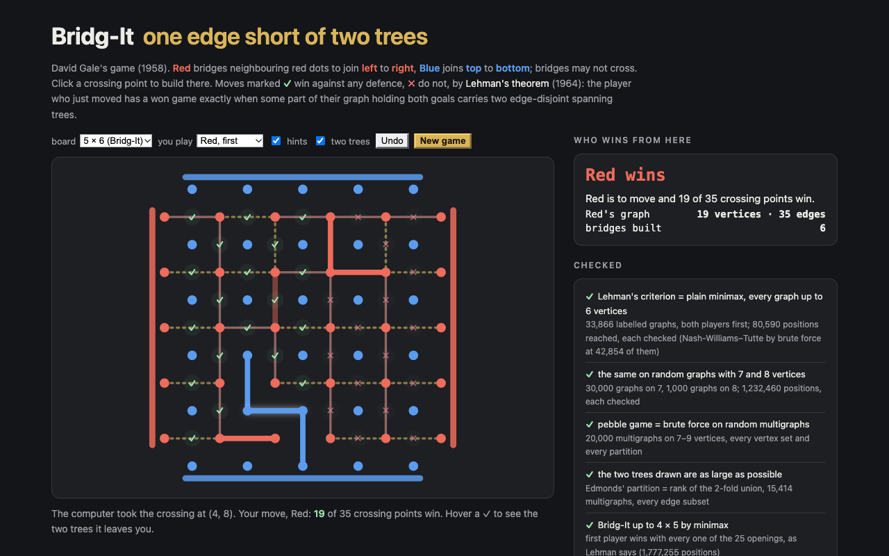

# Bridg-It

Bridg-It (David Gale's game, shown by Martin Gardner in *Scientific American*, October 1958) in the browser. **Red** bridges neighbouring red dots to join the left side to the right, **Blue** joins top to bottom, and bridges may not cross, so every crossing point goes to whoever takes it first. Every free crossing point is marked **✓** (wins against any defence) or **✗**, and hovering a ✓ draws the two spanning trees that move leaves you. A computer plays the other side.

The marks come from **Lehman's theorem** (1964) on the Shannon switching game, decided without search by a **(2,2) pebble game**: with the opponent to move, you win exactly when some part of your graph holding both goals carries two edge-disjoint spanning trees.



## Run it

```sh
npm install
npm run dev        # http://localhost:5173/portfolio/bridg-it/
npm test           # 12 tests
npm run build      # static site in dist/
```

## How it works

From Red's side, the board is a graph: Red's dots are vertices, the left column is one vertex *s*, the right column another *t*, and each crossing point is an edge. A red bridge claims an edge (contract it), a blue bridge across it deletes it. That is Shannon's switching game; Blue's side is the same game on Blue's graph.

On the n × (n+1) board Red's graph has V = n(n−1) + 2 vertices and E = n² + (n−1)² edges, while two spanning trees need 2(V − 1): **one edge short**. An opening contracts an edge (one vertex and one edge fewer) and leaves E = 2(V − 1). On every board computed, after **every** opening the edges split into exactly two spanning trees, so every opening wins (all 41 on the 5 × 6 board).

- `src/graph.ts`: multigraphs; `secondWins` (the (2,2) pebble game of Lee & Streinu: s and t share a two-tree part iff 3 pebbles cannot be gathered on them); `firstWins`; Nash-Williams–Tutte by brute force; a memoised `Minimax` that plays the game out (optionally dropping dead edges and trying Short's moves in Lehman's order; the verdicts come from the search); `treePacking` (Edmonds' matroid partition into two forests).
- `src/bridgit.ts`: the board (each crossing point is an edge of Red's graph and of Blue's), each player's graph (own bridges contracted with union–find, the opponent's deleted), winning moves, the two trees, the computer (a winning move, central ones first; otherwise the move that leaves the opponent the fewest winning replies).
- `src/main.ts`: the demo; the panel "checked" reads `src/findings.json`, written by `tools/report.mts`.

## Checked

```sh
npm run compute    # runs/compute.json
npm run exact      # Bridg-It 4 × 5 by minimax → runs/exact-4.json
node tools/report.mts
```

Node 26, one thread per run (`npm run compute` took 29 min, `npm run exact` 17 min):

| check | size | result |
|---|---|---|
| Lehman's criterion (pebble game) = plain minimax | every labelled graph on 2–6 vertices (33,866), both players first; all 80,590 positions reached | 0 mismatches; Nash-Williams–Tutte by brute force also at all 42,854 positions with Cut to move |
| the same, sampled | 30,000 random graphs on 7 vertices, 1,000 on 8; 1,232,460 positions | 0 mismatches |
| pebble game = brute force | 20,000 random multigraphs on 7–9 vertices | 0 mismatches |
| Edmonds' partition = rank of the 2-fold union | 15,414 random multigraphs, every edge subset | 0 mismatches |
| dropping dead edges keeps the outcome | every graph up to 6 vertices | 0 mismatches |
| Bridg-It by minimax | 3 × 4 (5,233 positions), 4 × 5 (1,777,255 positions, 1015 s) | first player wins with all 13 / 25 openings, second player loses; = Lehman |
| every opening wins and leaves exactly two spanning trees | every board 1 × 2 … 14 × 15 (41 openings on 5 × 6, 365 on 14 × 15) | no exception |
| no draws: Red's and Blue's graphs agree | 85,708 random positions, 2 × 3 … 9 × 10 | 0 disagreements |
| the computer moving first never loses | 560 games vs random play (3 × 4 … 7 × 8), 500 vs itself (3 × 4 … 5 × 6) | all won |

## License

MIT
